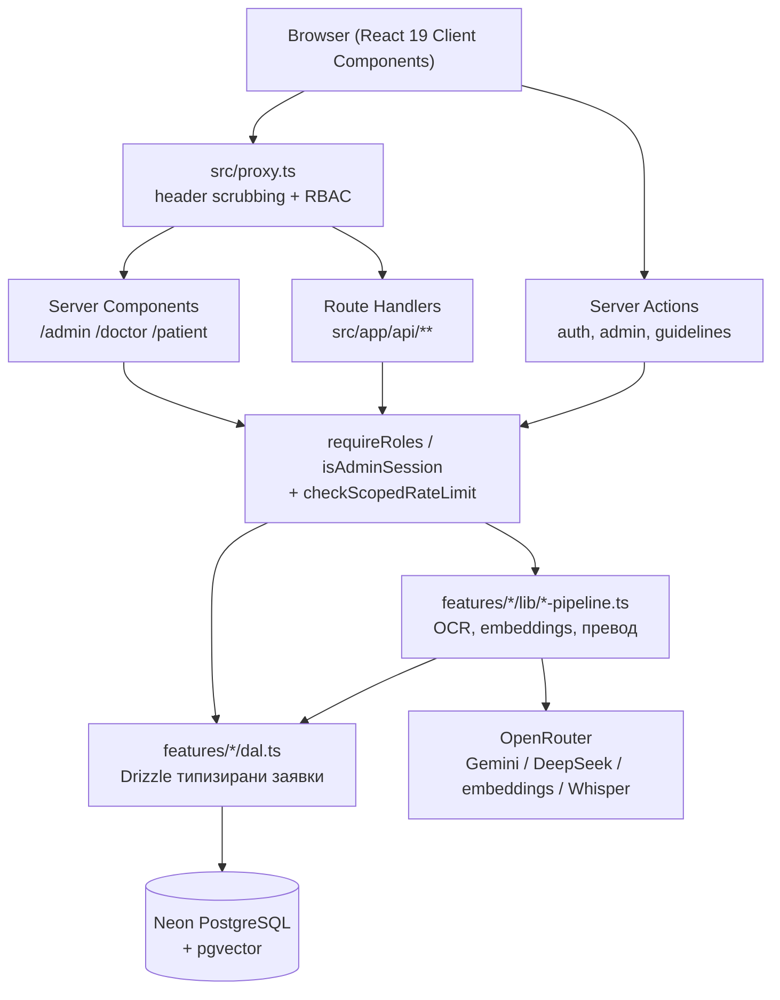
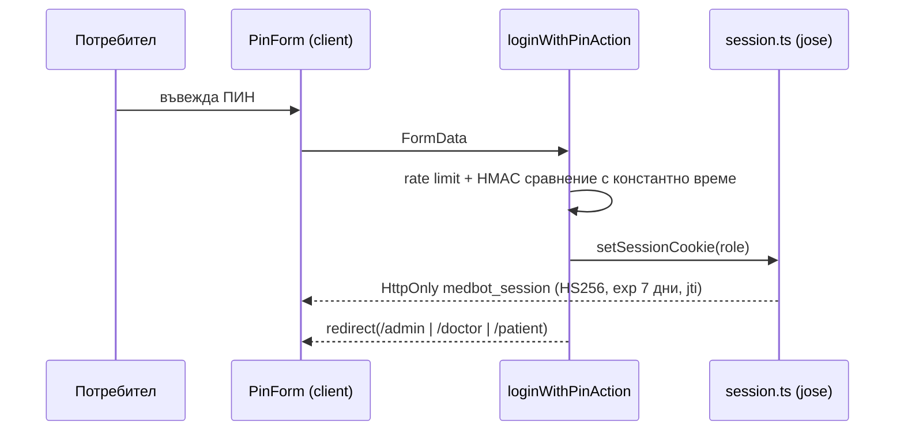
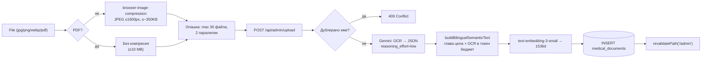
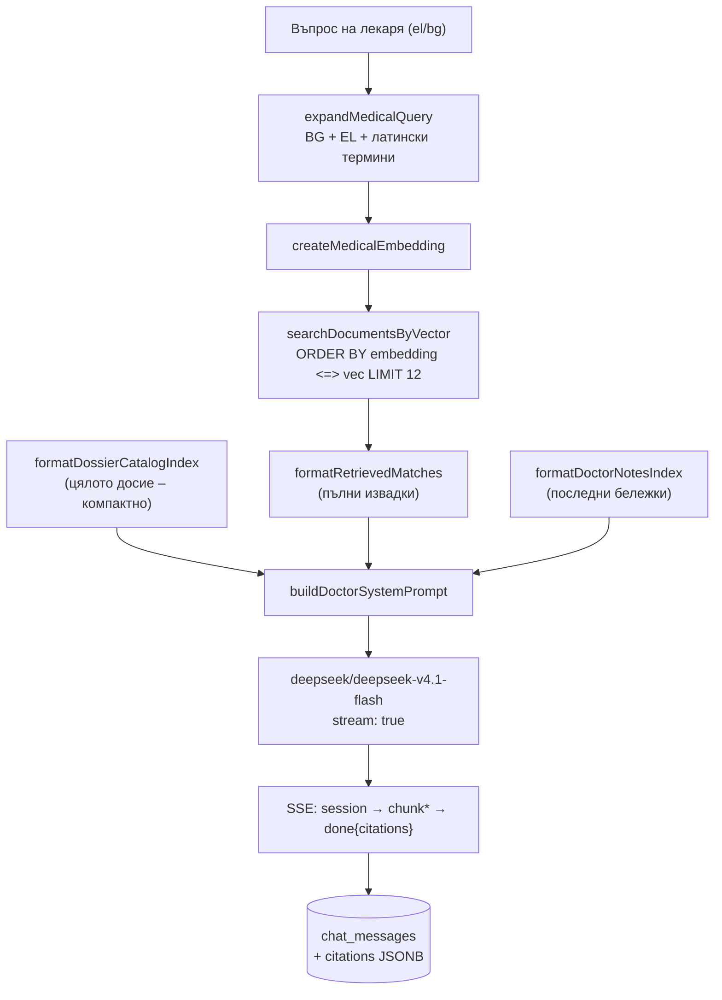
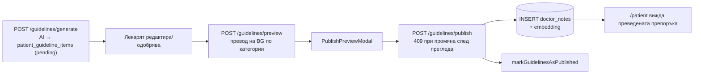

# 🏗️ Архитектура на MedBot RAG

Технически наръчник на двуезичната онкологична платформа **MedBot** (Български 🇧🇬 ⇄ Гръцки 🇬🇷): слоеве, потоци на данни, AI конвейери, бюджетиране на токени, сигурност и инженерни стандарти.

---

## 1. Архитектурни принципи

| Принцип | Как е реализиран |
| :--- | :--- |
| **Feature-based модулност** | Всяка функционалност живее в `src/features/<feature>` и експортира публичен API само през `index.ts`. |
| **Server-first** | Данните се зареждат в Server Components (`/admin`, `/doctor`, `/patient`), а мутациите минават през Server Actions или Route Handlers. Браузърът никога не говори директно с Neon. |
| **Defense in Depth** | Всяка проверка за роля се прави **два пъти**: в `src/proxy.ts` и в самия Route Handler / Server Action. |
| **No-Middleware Policy** | `middleware.ts` е забранен – използва се Next.js 16 `src/proxy.ts`. |
| **Стриктен TypeScript** | `strict: true`, без `any`; външни данни (JSONB, AI отговори, `unknown` JSON) се валидират със Zod или Type Guards. |
| **Egress оптимизация** | Списъчните заявки умишлено **не** извличат `file_base64`, `embedding`, `extracted_text` и `semantic_text`. |
| **Token Budget, не символи** | Всеки вход към модел с ограничен контекст се ограничава по **токени** чрез `estimateTokens` / `truncateToTokenBudget`. |

---

## 2. Слоеве на приложението

### Отговорности по слой

| Слой | Файлове | Отговорност |
| :--- | :--- | :--- |
| Proxy | `src/proxy.ts` | Изчистване на опасни `x-middleware-*` хедъри, пренасочване от `/`, RBAC за страници и API (`401` срещу `403`). |
| Страници | `src/app/**/page.tsx` | SSR зареждане (паралелно с `Promise.all`), Suspense fallback, `redirect('/')` при липса на права. |
| Route Handlers | `src/app/api/**/route.ts` | Валидация (Zod), ограничено тяло, rate limit, стрийминг (SSE), мапване на грешки към статуси. |
| Server Actions | `features/*/actions.ts` | Мутации от UI без отделен API маршрут; връщат дискиминатиран `ActionResult<T>`. |
| DAL | `features/*/dal.ts` | Единственият слой, който говори с Drizzle/Neon. Оптимизирани `select`, retry при cold start. |
| AI pipelines | `features/**/lib/*-pipeline.ts`, `lib/ai-pipeline.ts` | Промпти, OCR, embeddings, превод, обработка на грешки от доставчика. |

---

## 3. Потоци на данни

### 3.1 Вход с ПИН

### 3.2 Качване на документ (админ)

### 3.3 Лекарски RAG чат

> Каталогът (заглавия, дати, категории, маркери) влиза **винаги**, а пълните OCR извадки – само за топ 12 вектора. Така моделът знае за съществуването на всички документи, без да се плаща за целия корпус.

### 3.4 Пациентски чат

1. `requireRoles(['patient','admin'])` + rate limit 25/мин.
2. Валидация на сесията (`getPatientChatSessionById` → `404` при чужда).
3. `getRagContextBundle(question)` – векторно търсене и в `medical_documents`, и в `doctor_notes` (последните бележки влизат винаги).
4. Стрийминг `text/plain`; **след** приключване се записва ходът (`savePatientChatTurn`) – диалогът е записан преди клиентът да обнови историята си.
5. Пациентът получава само преведени текстове и линкове `/api/notes/{id}/file`; вътрешните `/api/doc/...` препратки се забраняват в промпта (`patient-prompts.ts`).

### 3.5 Обобщение на досието

- `getDossierForSummary()` → `buildDossierContext(docs, 400_000 токена)`.
- **Water-filling** разпределение: късите транскрипции влизат цели, неизползваният им бюджет се прехвърля към дългите.
- Клиничната глава (заглавие, дата, стадий, маркери, резюме) се пази **изцяло**; съкращава се само `extracted_text`, като се пазят началото **и** краят.
- Модел: `LONG_CONTEXT_MODEL` (`max_tokens: 12000`, `maxDuration: 300`). Отговорът се записва **само** при `finish_reason === 'stop'` и ≥ 200 знака.
- 8 фиксирани клинични глави на гръцки с **задължителен** цитат `[📄 Заглавие (YYYY-MM-DD)](/api/doc/ID)` за всяко твърдение.
- `computeStaleness()` сравнява `document_ids` с текущото досие → „X нови / Y премахнати документа“.

### 3.6 Чернови на насоки → публикуване към пациента

**Правило:** `patient_guideline_items` **никога** не се чете от пациентския портал. Пациентът вижда само резултата в `doctor_notes`. Публикуването е идемпотентно и транзакционно (`FOR UPDATE`), с конфликт при частично публикувана категория.

---

## 4. Бюджетиране на токени (критично)

| Място | Константа | Стойност | Защо |
| :--- | :--- | :--- | :--- |
| Semantic text за embedding | `MAX_EMBEDDING_INPUT_TOKENS` | **7 000** | Контекстът на `text-embedding-3-small` е **8192 токена**; остава буфер за главата |
| Retry при грешка за дължина | `RETRY_EMBEDDING_INPUT_TOKENS` | **4 000** | Еднократен повторен опит с по-малък бюджет |
| Извличане на RAG контекст | `SAFE_EMBEDDING_TOKEN_BUDGET` | **7 000** | Същата граница при заявките за търсене |
| Цялото досие | `DOSSIER_INPUT_TOKEN_BUDGET` | **400 000** | Моделът има 1M контекст; остава място за промпт и отговор |
| Vision OCR | `VISION_MAX_TOKENS` | **16 000** | Пълна транскрипция на плътен скан (~9 600 измерени) |
| Обобщение | `SUMMARY_MAX_TOKENS` | **12 000** | Дълъг структуриран Markdown |

**Тегла на `estimateTokens`** (калибрирани срещу `text-embedding-3-small`, умишлено леко завишени):

| Текст | Токена / знак |
| :--- | :--- |
| Гръцки (`U+0370–U+03FF`, `U+1F00–U+1FFF`) | **1.15** |
| Кирилица (`U+0400–U+04FF`) | **0.55** |
| Латиница / цифри / ASCII | **0.65** |
| Останали (CJK, символи) | **1.00** |

> ⚠️ 10 000 знака гръцки ≈ 11 500 токена → HTTP 400 от доставчика. Затова `String.slice(0, N)` е **забранен** за входове към AI.

`truncateToTokenBudget` пази 60% от началото и 40% от края с маркер `[… съкратено / περικομμένο …]` – диагнозата е в началото, заключението и подписът – в края. Използва двоично търсене по дължината на низа, а не фиксирана стъпка.

---

## 5. Сигурност

| # | Механизъм | Файл |
| :--- | :--- | :--- |
| 1 | Header scrubbing (`x-middleware-subrequest`, `x-middleware-rewrite`, `x-middleware-next`) – CVE-2025-29927 | `src/proxy.ts` |
| 2 | RBAC за страници (redirect) и API (`401` / `403`) | `src/proxy.ts` |
| 3 | ПИН с константно време (HMAC-SHA256 + `timingSafeEqual`) | `features/auth/lib/pin.ts` |
| 4 | JWT HS256 с `exp` + `jti`, HttpOnly, SameSite=Lax, `secure` в production | `features/auth/lib/session.ts` |
| 5 | `SESSION_SECRET` ≥ 32 знака, без fallback | `features/auth/lib/keys.ts` |
| 6 | `requireRoles()` / `requireAnyAuthenticatedRole()` в Route Handlers | `features/auth/lib/role-guard.ts` |
| 7 | `isAdminSession()` в административните Actions | `features/admin/lib/guard.ts` |
| 8 | Поточно ограничено тяло (`readBoundedJson`, `PayloadTooLargeError` → `413`) | `lib/http-payload.ts` |
| 9 | Scope-нат rate limiter по `jti` (fallback IP от `x-forwarded-for`) с периодично почистване | `features/auth/lib/role-guard.ts` |
| 10 | Пациентът няма достъп до `/api/doc/*` (сурови сканове) | `src/proxy.ts` + `api/doc/[id]/route.ts` |
| 11 | RLS на всички таблици + нулев директен достъп от браузъра до базата | `schema.sql` |

### Матрица на достъпа

| Ресурс | `admin` | `doctor` | `patient` | Анонимен |
| :--- | :---: | :---: | :---: | :---: |
| `/admin` | ✅ | ➡️ `/` | ➡️ `/` | ➡️ `/` |
| `/doctor` | ✅ | ✅ | ➡️ `/` | ➡️ `/` |
| `/patient` | ✅ | ➡️ `/` | ✅ | ➡️ `/` |
| `/api/admin/*` | ✅ | 403 | 403 | 401 |
| `/api/doctor/*`, `/api/chat/doctor` | ✅ | ✅ | 403 | 401 |
| `/api/chat/patient` | ✅ | 403 | ✅ | 401 |
| `/api/doc/*` | ✅ | ✅ | 403 | 401 |
| `/api/notes/upload` | ✅ | ✅ | 403 | 401 |
| `/api/notes/*` (четене + файл) | ✅ | ✅ | ✅ | 401 |
| `/api/transcribe` | ✅ | ✅ | ✅ | 401 |

---

## 6. Интернационализация (i18n)

- Речник: `src/features/i18n/locales/bg.json` и `el.json` с топ-ключове `common`, `auth`, `admin`, `doctor`, `patient`.
- Състоянието се държи от `useSyncExternalStore` + `localStorage['medbot_locale']` + cookie `medbot_locale` (1 година, `SameSite=Lax`), за да е еднакво между табове и достъпно на сървъра.
- `getClientSnapshot()` връща `el` за `/doctor` и `bg` за останалите, освен ако няма запазен избор; `getServerSnapshot()` връща `bg` (без hydration mismatch).
- `document.documentElement.lang` се синхронизира при всяка смяна (a11y + SEO).
- **Правило:** в компонентите няма hardcoded текст на друг език освен текущия – всичко минава през `t.*` или през двойка `*El` / `*Bg` стойности (напр. `NOTE_CATEGORY_LABELS_EL/BG`).
- Сървърните маршрути четат езика от cookie `medbot_locale` (напр. `/api/doctor/summary` връща грешките на езика на интерфейса).

---

## 7. Обработка на грешки

| Ситуация | Поведение |
| :--- | :--- |
| Невалиден JSON в тялото | `400` с четим текст |
| Неуспешна Zod валидация | `400` + `parsed.error.issues[0].message` |
| Тяло над лимита | `413` (`PayloadTooLargeError`) |
| Липсваща сесия / права | `401` / `403` (`AuthError`) |
| Чужда или липсваща сесия/документ | `404` (`SessionNotFoundError`) |
| AI върна невалиден JSON/данни | `502` (`PipelineError`, `NotePipelineError`, `RagError`) |
| Промяна между преглед и публикуване | `409` (`GuidelinePublishConflictError`) |
| Превишен rate limit | `429` |
| Клиентът прекъсне генерирането | `499` / тихо затваряне на потока, без запис в базата |
| Неочакван срив | `500` + `console.error`, без изтичане на stack trace към клиента |

Всички асинхронни операции са в `try/catch`; съобщенията към потребителя са на български (или на езика на интерфейса), а техническите детайли остават в сървърните логове.

---

## 8. Next.js 16 специфики, които проектът използва

- **`src/proxy.ts`** вместо `middleware.ts` (`export async function proxy` + `config.matcher`).
- **`params` е `Promise`** в Route Handlers: `const { id } = await context.params`.
- **`cookies()` / `headers()` са асинхронни**: `const cookieStore = await cookies()`.
- **`cacheComponents: true`** и **`partialPrefetching: true`** в `next.config.ts`; Tailwind v4 се зарежда през `turbopack.rules` с `@tailwindcss/turbopack`.
- **`maxDuration`** се декларира на ниво Route Handler (120 s за OCR/upload и guidelines, 300 s за обобщение на досието).
- **`revalidatePath`** след мутации (`/admin`, `/doctor`, `/patient`).
- **`server-only`** в началото на всеки DAL / AI модул; във Vitest се замества с `src/test/shims/server-only.ts`.

---

## 9. Инженерни стандарти

1. **No-Middleware Policy** – никакъв `middleware.ts`.
2. **Arrow Functions** за всички React компоненти (`const X: React.FC<Props> = () => {}`).
3. **Забранено `any`** – стриктни интерфейси или `unknown` + Type Guards (`isRecord`, `isUploadApiResponse`).
4. **`try/catch`** за всяка асинхронна операция и всеки Route Handler.
5. **Mobile-First**, десктоп Split-Screen с ресайз.
6. **Token Budget, не брой символи.**
7. **Никога не губи структурирани данни** при съкращаване – клиничната глава се пази изцяло, реже се само OCR текстът (начало + край).
8. **Egress оптимизация** – никакво извличане на `file_base64` / `embedding` в списъчни заявки.
9. **Тестове до кода** – `<name>.ts` ↔ `<name>.test.ts` в същата директория, до 300 реда на файл.
10. **Публичен API на feature** – само през `index.ts`; никакви deep import-и между features.

---

## 10. Известни ограничения

- **In-memory rate limiter** – работи коректно само в рамките на един Node процес. При multi-instance deployment трябва да се замени с Redis / Upstash.
- **Web Speech API** не е наличен във Firefox и част от мобилните браузъри – там автоматично се ползва `MediaRecorder` + Whisper.
- **OCR латентност** – плътен гръцки скан или многостраничен PDF отнема 40–60 s; затова `maxDuration = 120` и паралелност 2 в опашката.
- **Файловете се пазят като Base64 в PostgreSQL** – удобно и атомарно за ~30 документа, но не е подходящо за хиляди файлове (тогава – обектен сторидж).
- **Един пациент на инсталация** – моделът е оптимизиран за едно семейно досие, не за multi-tenant клиника.

