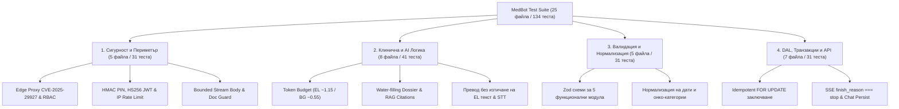

# 🧪 План за тестване и документация на тестовете: MedBot RAG

Тази документация описва стратегията, архитектурата, обхвата и правилата за автоматизирано тестване на **MedBot RAG** (двуезична онкологична платформа Български 🇧🇬 <-> Гръцки 🇬🇷).

---

## 1. Технологична конфигурация и команди

Тестовата среда е изградена с **Vitest v4** в `node` среда за максимална скорост (~650 ms чисто време за изпълнение на 132 теста) и пълна изолация от външни мрежови услуги (Neon PostgreSQL и OpenRouter AI се симулират детерминистично чрез `vi.mock`).

### Ключови конфигурационни файлове:
- **`vitest.config.mts`** – Резолюция на псевдонима `@/* -> ./src/*` и пренасочване на `server-only` към локален шим.
- **`src/test/shims/server-only.ts`** – Празен модул, позволяващ директно импортиране на сървърни DAL и AI модули във Vitest без грешка от Next.js runtime guard.

### Команди за изпълнение:
| Команда | Предназначение |
| :--- | :--- |
| `npm run test` | Еднократно изпълнение на всички тестови пакети (`vitest run`) – за локална проверка и CI/CD. |
| `npm run test:watch` | Интерактивен watch режим при разработка на нова функционалност (`vitest`). |
| `npx tsc --noEmit` | Пълна статична проверка на типовете (включително всички `*.test.ts` файлове, без `any`). |
| `npm run lint` | Проверка на кодовия стандарт чрез ESLint. |

---

## 2. Архитектура на тестовото покритие (4 стълба)

Обхватът включва **25 тестови файла** с общо **134 автоматизирани теста**, разпределени в четири критични стълба:

---

## 3. Пълен каталог на тестовите пакети

### 🛡️ Стълб 1: Сигурност, Автентикация и Защита на периметъра (31 теста)

| Тестов файл | Тестван модул | Брой | Покрити инварианти за сигурност |
| :--- | :--- | :---: | :--- |
| `src/proxy.test.ts` | `src/proxy.ts` | 9 | Премахване на `x-middleware-subrequest` / `x-middleware-rewrite` / `x-middleware-next` (CVE-2025-29927); задължително изискване за валиден `exp` клейм в JWT; пренасочване от `/` по роля; RBAC изолация на `/admin`, `/doctor`, `/patient` и API маршрутите (`401` срещу `403`). |
| `src/features/auth/auth-security.test.ts` | `pin.ts`, `session.ts`, `actions.ts` | 7 | Сравнение на ПИН с константно време чрез HMAC-SHA256 (`timingSafeEqual`); задължителна верификация за наличен `exp` клейм; подписване и верификация на HS256 JWT с `jti`; защита срещу подправен `X-Forwarded-For` при brute-force лимитиране. |
| `src/features/auth/lib/role-guard.test.ts` | `role-guard.ts` | 7 | Сървърна защита `requireRoles` (`401`/`403` `AuthError`) и изолиран по потребител (`jti`) rate limiter с автоматично нулиране след прозореца. |
| `src/lib/http-payload.test.ts` | `http-payload.ts` | 5 | Поточно четене на JSON с лимит по байтове (`PayloadTooLargeError` `413`), включително при фалшифициран малък `Content-Length` хедър. |
| `src/app/api/doc/[id]/route.test.ts` | `/api/doc/[id]` | 3 | Defense-in-depth забрана за достъп на `patient` (`403`) до сурови онкологични сканове, валидация на ID (`400`/`404`) и бинарно декодиране с `Cache-Control: private`. |

---

### 🧠 Стълб 2: Критична клинична и AI бизнес логика (41 теста)

| Тестов файл | Тестван модул | Брой | Покрити клинични и AI инварианти |
| :--- | :--- | :---: | :--- |
| `src/features/admin/lib/ai-pipeline.test.ts` | `ai-pipeline.ts` | 9 | Точна оценка на токени за гръцки (`1.15`), кирилица (`0.55`) и латиница; съкращаване със запазване на начало и край; 100% запазване на клиничната глава; автоматичен retry при HTTP 400 за надвишен 8192-токенов контекст. |
| `src/features/documents/lib/dossier-context.test.ts` | `dossier-context.ts` | 3 | Water-filling алгоритъм за справедливо разпределение на токен бюджета между кратки и дълги документи в онкологичното досие без орязване на метаданните. |
| `src/features/rag/lib/embeddings.test.ts` | `embeddings.ts` | 7 | Генериране на 1536-измерен вектор в безопасен бюджет от 7000 токена, валидация на размерността и двуезично разширяване на онкологични термини с плавен fallback. |
| `src/features/doctor/lib/rag-engine.test.ts` | `rag-engine.ts` | 8 | Извличане и дедупликация на цитати `[📄 Заглавие](/api/doc/ID)` от Markdown отговори, форматиране на пълния каталог на досието и BG/EL системни инструкции. |
| `src/features/doctor-notes/lib/note-ai-pipeline.test.ts` | `note-ai-pipeline.ts` | 4 | Изчистване на Markdown огради при JSON отговор, fallback на категорията при невалидна стойност и активиране на `cloudflare-ai` PDF парсер за прикачени протоколи. |
| `src/features/patient-guidelines/lib/publish-pipeline.test.ts` | `publish-pipeline.ts` | 4 | Забрана за публикуване на непреведен гръцки текст към българския пациент при липсващ `note_bg`; идемпотентно пропускане на вече публикувани категории. |
| `src/features/patient/lib/patient-prompts.test.ts` | `patient-prompts.ts` | 2 | Дедупликация на лекарски бележки по `id`, рендиране на линкове `/api/notes/{id}/file` и стриктна забрана за вътрешни `/api/doc/...` препратки към пациента. |
| `src/features/voice/lib/transcribe-server.test.ts` | `transcribe-server.ts` | 4 | Изпращане на гласови записи единствено към `/api/v1/audio/transcriptions` (STT endpoint за `whisper-large-v3`), изчистване на `data:` префикс и обработка на грешки. |

---

### ✅ Стълб 3: Zod Валидация и Нормализация на данни (31 теста)

| Тестов файл | Тестван модул | Брой | Покрити правила за валидация |
| :--- | :--- | :---: | :--- |
| `src/features/admin/schemas-and-normalize.test.ts` | `normalize.ts`, `schemas.ts` | 6 | Синонимно мапване на категории (BG/EL/EN -> 6 канонични категории), преобразуване на дати `DD.MM.YYYY` -> `YYYY-MM-DD`, проверка на MIME типове и размер до 6 MB. |
| `src/features/patient-guidelines/schemas.test.ts` | `patient-guidelines/schemas.ts` | 10 | Лимити на клинични насоки (3–1500 знака), статус преходи, валидация на пакета за публикуване (минимум 1 одобрен ID, непразен превод). |
| `src/features/patient/schemas.test.ts` | `patient/schemas.ts` | 8 | Валидация на UUID v4 за чат сесии, дължина на въпросите (1–2500 знака), локализация (`bg` / `el`) и заглавия на сесии. |
| `src/features/doctor-notes/schemas.test.ts` | `doctor-notes/schemas.ts` | 4 | Текстови бележки от лекаря и качване на PDF/изображения с предписания (MIME whitelist и Base64 лимит до ~5 MB). |
| `src/features/voice/schemas.test.ts` | `voice/schemas.ts` | 3 | Аудио формати за диктовка (`webm`, `mp3`, `wav`, `ogg`, `m4a`, `mp4`) и разрешени езици (`bg`, `el`). |

---

### 🗄️ Стълб 4: DAL Слой, Транзакции и API Стрийминг маршрути (31 теста)

| Тестов файл | Тестван модул | Брой | Покрити транзакционни и API сценарии |
| :--- | :--- | :---: | :--- |
| `src/features/patient/dal.test.ts` | `patient/dal.ts` | 9 | Филтриране на сесии по `role = 'patient'`, препращане на DB грешки без маскиране като `null` и хвърляне на типизирана `SessionNotFoundError`. |
| `src/features/patient-guidelines/publish-dal.test.ts` | `publish-dal.ts` | 7 | Транзакционно заключване на редове (`FOR UPDATE`), идемпотентен резултат `'already_published'` при паралелен повторен опит и `GuidelinePublishConflictError` при променен статус, категория или текст. |
| `src/features/dossier-summary/dal.test.ts` | `dossier-summary/dal.ts` | 3 | Изчисляване на актуалност на клиничното обобщение (`computeStaleness`: брой нови `newCount` и премахнати `removedCount` документи). |
| `src/app/api/doctor/guidelines/publish/route.test.ts` | `POST /api/doctor/guidelines/publish` | 4 | Консистентност между преглед и база (`409` при дублирани ID-та, ID от чужда категория или новоодобрена липсваща точка; `200` при пълен синхрон). |
| `src/app/api/doctor/summary/route.test.ts` | `POST /api/doctor/summary` | 3 | Ранно прекратяване със статус `499` при прекъснат `AbortSignal`; запис на обобщение само при `finish_reason === 'stop'` и дължина >= 200 знака. |
| `src/app/api/chat/patient/route.test.ts` | `POST /api/chat/patient` | 2 | Изчакване на `savePatientChatTurn` преди `controller.close()` в потока, гарантиращо записан диалог преди клиента да обнови историята си; `404` при чужда/липсваща сесия. |
| `src/app/api/patient/sessions/[sessionId]/route.test.ts` | `PATCH / DELETE /api/patient/sessions/[id]` | 3 | Разграничаване на `SessionNotFoundError` (`404`) от неочаквани системни/DB сривове (`500`) и неоторизирани роли (`401`). |

---

## 4. Стандарти за добавяне на бъдещи тестове

1. **Колокация до изходния код:** Всеки нов модул `src/features/<feature>/lib/<name>.ts` получава съседен файл `<name>.test.ts` в същата директория.
2. **Строг TypeScript (Без `any`):** Всички тестови двойници (mocks) използват реалните интерфейси на проекта (`SessionPayload`, `DocumentCatalogItem`, `PatientGuidelineItemEntity`) и `vi.mocked(...)`.
3. **Пълна изолация от БД и платени AI модели:** Никога не се правят реални заявки към `DATABASE_URL` или `OPENROUTER_API_KEY` по време на unit тестове. При `vi.importActual` на DAL модули задължително се добавя `vi.mock('@/lib/db', () => ({ db: {} }))`.
4. **Лимит от 300 реда:** Всеки тестов файл трябва да остане под 300 реда; при разрастване се разделя тематично (напр. отделно за схеми, AI пайплайн и DAL).
